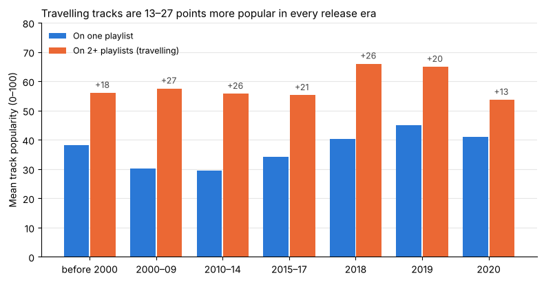

# Which Spotify tracks travel across playlists?

An exploratory analysis in **pandas** of ~32,800 Spotify playlist entries, asking what sets apart
the tracks that appear on several playlists ("travelling" tracks) from the ones that appear on
just one.



## Key findings

- **Only ~10 % of tracks travel.** 25,538 of 28,356 tracks appear on a single playlist.
- **Travelling tracks don't sound different.** Danceability, energy and valence are within about
  0.02 (on a 0–1 scale) of the other tracks.
- **They are far more popular:** ~60 vs. 37 on average. The gap grows with a stricter definition
  (≈ 71 at 3+ playlists, ≈ 84 at 5+).
- **It isn't a release-year effect.** Both groups have the same median release year (2016), and
  the gap holds in every release era and every genre family.

## What the analysis involved

- **Defining the unit of analysis.** One row of the raw file is a track *on a playlist*, and
  some playlists list the same track several times, so reach is counted as *distinct* playlists.
- **Repairing a broken lookup table.** The subgenre→family table had a conflicting entry, a
  capitalisation mismatch and a missing subgenre. Each fix is justified from the data itself
  (`playlist_genre`), taking unlabelled tracks from 2,636 to 0.
- **Robustness checks.** Three cut-offs for "travelling", comparisons within release eras,
  within genre families and without zero-popularity tracks.
- **A decision log** listing every analytical choice and what it costs.

## Run it

```bash
pip install -r requirements.txt
jupyter notebook spotify_playlist_reach.ipynb
```

The data is read directly from the AAU course repository, so nothing needs downloading. It comes
from the public [TidyTuesday Spotify songs dataset](https://github.com/rfordatascience/tidytuesday/tree/master/data/2020/2020-01-21)
(January 2020).

## Background

This started as the first group assignment of the MSc in Business Data Science at Aalborg
University (2026), by Group 7: Andrei Busuioc, Brett Taylor Ulsh, Iva Omrcen,
Junayed Ahmad Sojib and Morten Lybye Verwohlt.

This repository is a cleaned-up and extended version by Andrei Busuioc. Compared with the
submitted assignment, it fixes a bug where the release-year check ran on the wrong definition of
"travelling", repairs the genre lookup from evidence rather than by dropping rows, and assigns
each track's genre family across all its playlists instead of from its first row.
